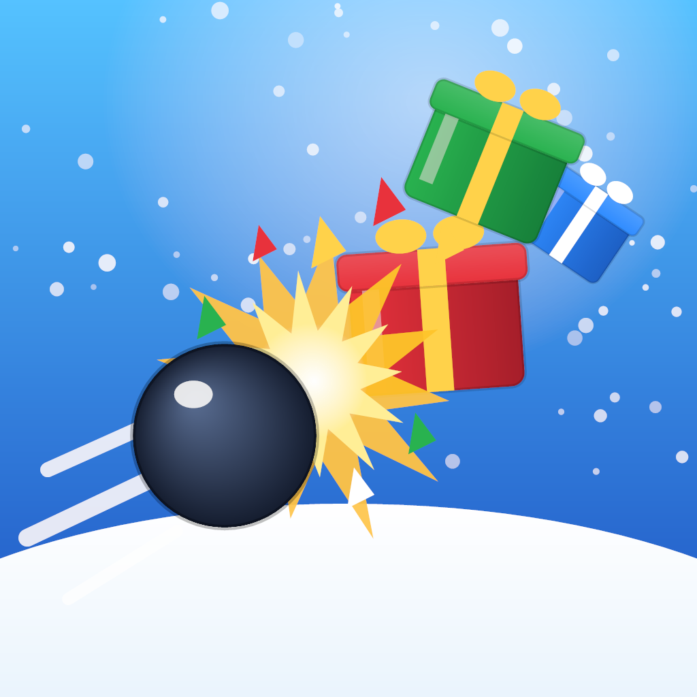

<div align="center">


https://github.com/user-attachments/assets/b5fba138-d3e0-49c4-95d5-23c376389996


</div>

<div align="center">
  
  <!-- Gameplay video: drag an .mp4 into the GitHub editor and paste the generated link below -->
  <!-- <video src="https://github.com/user-attachments/assets/..." controls></video> -->
</div>


# 🎄 Smash Fest

Hypercasual physics smasher built in **Unity 6** (`6000.3.21f1`) with the **Universal Render Pipeline** and a warm toon look from **Toony Colors Pro 2**. Gameplay systems are wired with **Zenject**, async flows run on **UniTask**, UI motion uses **DOTween** and haptics use **Nice Vibrations**. Levels are data-driven: 1000 hand-tunable layouts live in a JSON database, and later cycles are generated procedurally by a seeded level architect. Every level in the database was verified to be beatable by an automated bot.

## 📌 Overview

The player aims a Christmas cannon by tapping the screen and launches balls at towers of gifts, logs, cans, ice and jam jars stacked on festive tables. Glass blocks and jam jars shatter when the ball hits them; every other target only breaks when it falls to the ground, so the goal is to topple the towers rather than chip at them.

The level is won when every target is destroyed. It is lost when the cannon is out of balls and the last ball has settled. Clearing a level earns one to three stars, based on how many balls are left, and coins that can be spent on ball skins. Every 10th level is a bonus level built from colourful jam jars with unlimited balls and a triple reward. Progress, coins, skins and settings persist as JSON between sessions. Each level is spawned into a single game scene from `LevelData`; levels are not separate scenes.

## 🔧 Core Features

- **Stable stacking physics.** Blocks stay kinematic (dormant) until a ball or a fast-moving body hits them. A woken block transfers part of the impact and wakes the blocks resting on top of it, so towers never collapse on their own.
- **Pre-baked fracturing.** Every block ships with Voronoi pieces baked in the editor. Breaking only swaps the intact mesh for its pieces; the pieces then shrink and fade through a `MaterialPropertyBlock` on dedicated transparent materials.
- **Clear break rules.** Glass and jam jars break on a ball hit, the rest break on ground contact, and tables never break.
- **Material-aware feedback.** `ImpactFeedback` plays per-material hit and break sounds and emits debris tinted with each material's average texture colour, sampled once with `AsyncGPUReadback` so it never stalls the GPU.
- **Level Blueprint editor.** A custom editor window paints, moves and validates blocks on a 3D grid, previews the level in the Scene view, and regenerates the whole JSON database.
- **Procedural levels.** `LevelArchitect` builds seeded layouts (single tables, twin tables, arches, shelves, glass weak points) with stability checks, used for every level after the first cycle.
- **Exact ballistic aiming.** `BallisticSolver` computes the launch velocity that lands the ball exactly on the tapped point under gravity; shots into empty space follow a natural arc instead of flying forever.
- **Fair levels.** Targets that fall off the table count as destroyed, and every level's ball budget was tuned from bot playthroughs so no level is unbeatable.
- **Bonus levels.** Every 10th level swaps its targets for jam jars in seven flavours, picked deterministically per level and block.
- **Game feel.** Breaks build combos (`ComboCounter`, `ComboPopup`), and Nice Vibrations plays a soft tick on each break and a firmer kick on every shot. A tap tutorial appears on the first level and after a few idle seconds.
- **Stars, coins and skins.** `LevelRewardRules` scores each clear; coins unlock eight ball skins in the shop (`BallSkinShop`), each with its own fade material.
- **Themes.** `EnvironmentThemer` switches between winter, autumn, spring and night every 50 levels. The whole background is one merged mesh with a single material, and each theme only swaps a 4x4 colour-palette texture.
- **Camera framing.** The camera is parented to the cannon; `LevelFraming` slides the cannon along Z until the level's width fits the view.
- **Object pooling.** Blocks and balls come from a prewarmed `PrefabPool`; one-shot sounds come from a `SoundEmitterPool` built on `UnityEngine.Pool`. Nothing is created at runtime; every object comes from a prefab.
- **Allocation-free UI motion.** Panels slide and pop in with DOTween tweens that are built once and replayed, so opening a panel allocates nothing. The level list recycles a fixed window of buttons.
- **Mobile performance.** `FrameRateService` locks the frame rate and lowers the render scale on devices that cannot hold it. Materials run on the SRP Batcher, only blocks and the ball cast shadows, block textures are 1024 px ASTC, and fracture meshes are compressed.
- **Persistence and settings.** `PlayerDataStore` writes `player_data.json` through a temp file and migrates older `PlayerPrefs` saves. Music, sound effects and vibration can be toggled separately.

## 🧩 Gameplay Flow

1. **Boot.** `InitScene` runs `InitBootstrapper`, which shows the splash panel with a loading bar and then loads `MainMenuScene`.
2. **Menu.** The player scrolls the level list, picks an unlocked level and starts the game. Settings (music, sound and vibration) and the ball-skin shop can be opened from the menu.
3. **Build.** `GameScene` loads. `GameSceneController` asks `LevelSpawner` to spawn the selected `LevelData`, `EnvironmentThemer` applies the level's theme, then `LevelFraming` positions the cannon and camera.
4. **Aim and fire.** A tap is turned into an aim point by `AimResolver` and a launch velocity by `BallisticSolver`; the barrel turns toward it and fires a pooled ball.
5. **Smash.** Blocks wake, topple and break according to their material. Broken pieces fade out and return to the pool.
6. **Win.** When no targets remain, the success panel reveals the stars and coins, confetti and the jingle play, and the next level is unlocked.
7. **Fail.** When the cannon is empty and the last ball has settled, the fail panel and jingle play. The player can retry or return to the menu.

## 🏗️ Architecture

Dependency injection is Zenject. There are no singletons; services are bound to interfaces and injected. Scene flow uses three scenes; level content is built in place from data.

| Installer | Scope | What it binds |
| --- | --- | --- |
| `ProjectInstaller` | Project context | `SceneFlowManager`, `PrefabPool`, `SoundEmitterPool`, `AudioService`, `HapticService`, `PlayerProgressService`, `CoinWallet`, `SkinInventory`, `BallSkinShop`, `FrameRateService`, `UIManager`, data assets |
| `MainMenuSceneInstaller` | `MainMenuScene` | Opens the main menu panel |
| `GameSceneInstaller` | `GameScene` | `GameSceneController`, `LevelSpawner`, `LevelFraming`, `ImpactFeedback`, `BreakParticles`, `ComboCounter`, `EnvironmentThemer`, `BreakHintPicker`, `ShotHintScheduler`, cannon input and camera |

**ScriptableObjects**

- `BlockCatalogSO` — block families and standalone blocks; `BlockVariantBuilder` expands each family into length and axis variants. `Assets/_Project/Data/BlockCatalog.asset`.
- `LevelDatabaseSO` — points to the JSON level database and the block catalog. `Assets/_Project/Data/LevelDatabase.asset`.
- `SoundLibrarySO` — music, per-material impact sounds, UI clicks and level jingles.
- `UICatalogSO` / `PoolConfigSO` — UI prefabs and pool prewarm sizes.
- `BallSkinCatalogSO` — ball skins with price, icon, solid and fade materials. `Assets/_Project/Data/BallSkinCatalog.asset`.
- `LevelThemeCatalogSO` / `LevelThemeSO` — themes with skybox, fog, snowfall, gifts and the background material. `Assets/_Project/Data/Themes/`.

**Runtime services**

- `GameSceneController` — level lifecycle, win and fail rules, HUD updates.
- `LevelSpawner` / `LevelLayout` — spawns blocks and converts grid placements into world poses.
- `LevelFraming` — fits the level into the camera view.
- `CannonController` / `CannonBarrel` / `AimResolver` / `BallisticSolver` — input, aiming, recoil and firing.
- `SpawnedBlock` / `BlockPhysics` / `BlockFracture` — dormant physics, break rules and shattering.
- `LevelArchitect` — seeded procedural layouts, split into composer, placer, stabilizer and module classes.
- `ImpactFeedback` / `BreakParticles` / `HapticService` / `ComboCounter` — audio, particle, haptic and combo feedback.
- `EnvironmentThemer` — per-theme background material, skybox and props.
- `UIManager` (`IUIManager`) / `PanelAnimator` — panel stack and DOTween transitions.
- `PlayerProgressService` / `PlayerDataStore` — progress, stars, settings and disk persistence.
- `CoinWallet` / `SkinInventory` / `BallSkinShop` — coins, owned skins and the selected ball.

Async delays, piece fading, sound release and scene loading use `UniTask` with cancellation tokens. Runtime tints never touch `renderer.material`.

## 📁 Project Structure (Simplified)

```text
SmashFestClone/
├── Assets/
│   ├── _Project/
│   │   ├── Art/
│   │   │   ├── FracturedMeshes/     # Baked Voronoi pieces
│   │   │   ├── Materials/           # Block, ball skin, environment, particle and fade materials
│   │   │   ├── Meshes/              # Merged background meshes
│   │   │   ├── Models/              # Cannon, ball and block models
│   │   │   ├── Textures/            # Block atlases, effects, theme palettes
│   │   │   └── UI/                  # Fonts, icons, sprites
│   │   ├── Audio/                   # Impacts, music, UI pops, jingles
│   │   ├── Data/                    # Block catalog, level database, sound library, UI catalog, skins, themes
│   │   ├── Prefabs/
│   │   │   ├── Blocks/              # Every block with intact and fractured visuals
│   │   │   ├── Environment/         # Snowfall
│   │   │   ├── Gameplay/            # Cannon, ball
│   │   │   ├── Systems/             # Break effects, confetti, sound emitter
│   │   │   └── UI/                  # Canvas, level button, panels
│   │   ├── Resources/Levels/        # LevelsDatabase.json
│   │   ├── Scenes/
│   │   │   ├── InitScene.unity
│   │   │   ├── MainMenuScene.unity
│   │   │   └── GameScene.unity
│   │   └── Scripts/
│   │       ├── Audio/               # Audio service, emitters, sound library
│   │       ├── Core/                # Pooling, effects, feel (combo, haptics), frame rate
│   │       ├── Data/                # Level data, layout, block catalog, JSON repository
│   │       ├── Editor/              # Level Blueprint editor, fracture baker, tools
│   │       ├── Environment/         # Themes and environment themer
│   │       ├── Flow/                # Scene flow
│   │       ├── Fracture/            # Voronoi mesh fracturing
│   │       ├── Gameplay/            # Cannon, barrel, projectile, ballistic solver, input
│   │       ├── Installers/
│   │       ├── Level/               # Spawner, framing, architect, blocks, hints
│   │       ├── Progress/            # Player data, coins, skins, rewards, persistence
│   │       ├── Scenes/              # Game session controller, bootstrapper, hint scheduler
│   │       ├── Shop/                # Ball skin catalog and shop
│   │       └── UI/                  # UI manager, panels, popups, animations
│   ├── JMO Assets/                  # Toony Colors Pro 2
│   ├── Plugins/
│   │   ├── Zenject/
│   │   ├── Demigiant/               # DOTween
│   │   └── NiceVibrations/          # Haptics
│   └── Settings/                    # URP assets
├── Packages/                        # Manifest plus embedded UniTask, UI Particle and editor tools
└── ProjectSettings/
```

## 🛠️ Tech Stack

| Technology | Role in this project |
| --- | --- |
| Unity `6000.3.21f1` | Editor and player |
| Universal Render Pipeline `17.3.0` | Rendering |
| Zenject (Extenject) | Installers, injection, prefab instantiation |
| UniTask | Scene loading, delays, fading, sound release |
| DOTween | Panel transitions, popups, splash and result animations |
| Toony Colors Pro 2 | Hybrid toon shader for every model, SRP Batcher compatible |
| Nice Vibrations | Haptic presets on Android and iOS |
| Input System `1.20.0` | Pointer and touch input |
| TextMeshPro / uGUI | Menu, HUD, popups |
| `JsonUtility` | Level database and `player_data.json` |
| `MaterialPropertyBlock` | Per-instance fragment fading without material clones |
| `AsyncGPUReadback` | Non-blocking texture colour sampling for debris |

## 📁 Note:

1. Clone or download the repository and open the folder in **Unity `6000.3.21f1`** through Unity Hub. Nothing else needs to be installed: there is no Git LFS, and Git itself is not required. Every third-party dependency ships with the project:
   - Zenject, DOTween and Nice Vibrations under `Assets/Plugins`, and Toony Colors Pro 2 under `Assets/JMO Assets`.
   - UniTask, UI Particle, Unity Toolbar Extender, Custom Play Button and Unity MCP as embedded packages under `Packages/`.
   - Unity's own packages (URP, Input System, TextMeshPro and others) are resolved by the Unity registry on first open.

   Add **Android Build Support** to the editor in Unity Hub to build the APK.
2. Build order is `InitScene` → `MainMenuScene` → `GameScene`. Enter Play Mode from **`Assets/_Project/Scenes/InitScene.unity`**. That scene loads the main menu; the menu loads `GameScene`.
3. Levels live in **`Assets/_Project/Resources/Levels/LevelsDatabase.json`**. Edit them with **Tools → SmashFest → Level Blueprint Editor**, which can also regenerate all 1000 levels.
4. Block families, masses and scale are in **`Assets/_Project/Data/BlockCatalog.asset`**. Sounds and volumes are in **`Assets/_Project/Data/SoundLibrary.asset`**.
5. Progress is stored as `player_data.json` under `Application.persistentDataPath`. In the Editor, use **Tools → SmashFest → Open Persistent Data Folder** to inspect or reset it.

## 🎵 Credits

- Impact sounds — [Kenney Impact Sounds](https://kenney.nl/assets/impact-sounds) (CC0).
- Font — [Lilita One](https://fonts.google.com/specimen/Lilita+One) (SIL Open Font License).
- Music — *Jingle Bells* (public domain), arranged and synthesized for this project. UI pops and level jingles are synthesized in-house.
